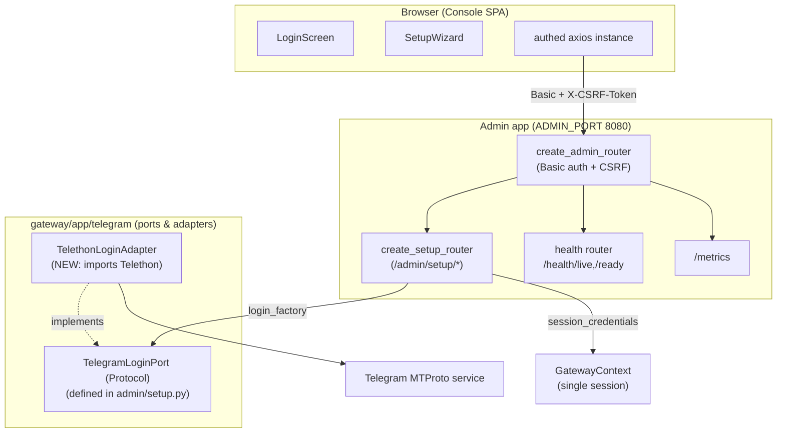
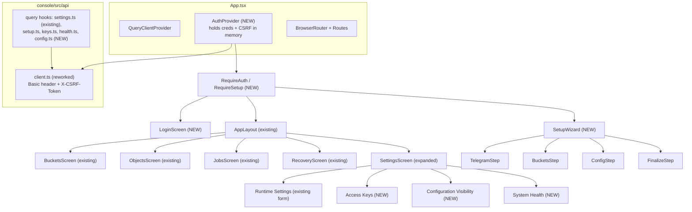

# Design Document

## Overview

The **admin-dashboard** feature turns the existing tgobjects3 Console stub into a
working, deployable operator dashboard. The backend already ships the Admin API
(`gateway/app/admin/router.py`), the first-run setup wizard
(`gateway/app/admin/setup.py`), the health/metrics endpoints, and a five-screen
React SPA (`console/`). This feature does **not** re-specify those; it closes the
concrete gaps that stop the dashboard working end to end and records the result
as a Figma design deliverable backed by a documented design system.

The work splits into four tracks:

1. **Backend** — a Telethon-backed interactive-login adapter under
   `gateway/app/telegram/` that implements the `TelegramLoginPort` protocol from
   `gateway/app/admin/setup.py`, a `TelegramLoginFactory` that builds it, and a
   one-call change in `gateway/app/main.py` (`_build_setup_router`) to inject the
   factory so `POST /admin/setup/telegram` stops returning HTTP 503. No new auth
   *surface* is added: the Console is realigned to the backend's existing HTTP
   Basic + `X-CSRF-Token`-header model, so the CSRF bootstrap reuses an existing
   authenticated `GET` rather than a new endpoint.
2. **Frontend** — an auth context/provider that holds the admin credentials in
   memory for the session and performs the CSRF bootstrap; a reworked
   `console/src/api/client.ts` that drops the cookie assumption and uses a Basic
   `Authorization` header plus the in-memory CSRF token; a `LoginScreen`; a
   `SetupWizard` (Telegram → Buckets → Config → Finalize); and an expanded
   settings area (Runtime Settings + Access Keys + Configuration Visibility +
   System Health).
3. **Deploy** — the missing `deploy/Dockerfile.console` (multi-stage: Node build
   of the Vite bundle → nginx serving static assets) and an nginx config that
   proxies `/admin`, `/health`, and `/metrics` to the gateway and falls back to
   `index.html` for client-side routes.
4. **Design** — a documented design system (tokens, type/space scales, control
   states, interaction patterns) consistent with `console/src/styles.css`, and a
   Figma capture of the running dashboard as a design record.

Non-goals / invariants preserved: the S3 API and SigV4 path are untouched; the
Telegram ports-and-adapters boundary is preserved (only the new adapter imports
Telethon); operator-supplied Telegram credentials are entered at runtime and
never stored in the repository.

## Architecture

### Backend component view



`gateway/app/main.py::_build_setup_router` is the single wiring change: it builds
`TelegramLoginFactory` and passes it to `create_setup_router(context=..., login_factory=...)`.

### Sequence: Dashboard login + CSRF bootstrap (Basic + header model)

The backend uses HTTP Basic auth (fixed username `admin`, password from
`TGOS3_ADMIN_PASSWORD`) and returns the per-session CSRF token in the
`X-CSRF-Token` **response** header on any authenticated request; it sets **no
cookie**. The Console therefore authenticates by caching the credentials in
memory and reusing an existing authenticated `GET` to obtain the token.

```mermaid
sequenceDiagram
  participant U as Operator
  participant L as LoginScreen
  participant P as AuthProvider
  participant C as axios (adminClient)
  participant A as Admin API

  U->>L: enter admin password, submit
  L->>P: signIn(password)
  Note over P: hold {username:"admin", password} in memory only
  P->>C: GET /admin/buckets  (Authorization: Basic ...)
  C->>A: GET /admin/buckets
  alt credentials accepted
    A-->>C: 200  + header X-CSRF-Token: <token>
    C-->>P: response (interceptor caches token in memory)
    P-->>L: authenticated = true
    L->>U: navigate to administrative screens
  else credentials rejected
    A-->>C: 401 WWW-Authenticate: Basic
    C-->>P: 401
    P-->>L: error; stay on login, keep username, clear secret
  end
```

The bootstrap `GET` is any already-authenticated read; `GET /admin/buckets`
(Requirement 19.1) is used because it exists, is cheap, and doubles as a
credential check. No new endpoint is introduced (Requirements 1.2, 1.5, 11.4).

### Sequence: interactive Telegram login (start → needs_code → submit, 3 attempts)

```mermaid
sequenceDiagram
  participant U as Operator
  participant W as SetupWizard (Telegram step)
  participant A as /admin/setup/telegram
  participant S as SetupSession (closure)
  participant Ad as TelethonLoginAdapter
  participant TG as Telegram

  U->>W: api_id, api_hash, login (phone/bot)
  W->>A: POST {api_id, api_hash, login}
  A->>Ad: start_login(api_id, api_hash, login)
  Ad->>TG: connect + send_code_request
  TG-->>Ad: code required
  Ad-->>A: TelegramLoginResult(needs_code=true)
  A-->>W: {needs_code:true, attempts_remaining:3}
  W->>U: prompt for code

  loop up to MAX_TWO_FACTOR_ATTEMPTS (3)
    U->>W: enter code
    W->>A: POST {..., code}
    A->>Ad: submit_code(code)
    alt code accepted
      Ad->>TG: sign_in(code) [+ 2FA password if needed]
      TG-->>Ad: authorized
      Ad-->>A: TelegramLoginResult(authenticated=true, session_credentials)
      A->>S: record session_credentials
      A-->>W: {authenticated:true}
      W->>U: advance to Buckets step
    else wrong code
      Ad-->>A: raise TwoFactorFailedError
      A->>S: two_factor_failures += 1
      alt failures < 3
        A-->>W: {needs_code:true, attempts_remaining:n}
      else failures == 3
        A->>Ad: reset()
        A->>S: reset_login()
        A-->>W: 401 authentication failed
        W->>U: error; restart credential entry
      end
    end
  end
```

The attempt counting, abort, and `reset()` live in `admin/setup.py` already
(`_submit_two_factor`, `_abort_login`). The adapter only provides `start_login`,
`submit_code`, and `reset`, and must raise `TwoFactorFailedError` for a wrong
code and `TelegramError` subclasses for everything else.

### Console SPA component diagram



New pieces slot in without rewriting the existing app: `App.tsx` wraps the router
in `AuthProvider` and adds `/login` and `/setup` routes guarded by `RequireAuth`
and `RequireSetup`; existing screens and `AppLayout` are reused unchanged except
for a logout control in the sidebar.

## Components and Interfaces

### Backend

#### New module: `gateway/app/telegram/login_adapter.py`

The one new backend module. It is the second place (after `adapter.py`) allowed
to import Telethon, consistent with the ports-and-adapters rule. It implements
the `TelegramLoginPort` Protocol defined in `gateway/app/admin/setup.py`.

```python
from __future__ import annotations

from gateway.app.admin.setup import (
    TelegramLoginPort,
    TelegramLoginResult,
    TwoFactorFailedError,
)
from gateway.app.config import Settings


class TelethonLoginAdapter:
    """Interactive first-run Telegram login backed by Telethon.

    Holds one in-progress ``telethon.TelegramClient`` between ``start_login``
    and ``submit_code`` so the send-code → sign-in → 2FA exchange runs against a
    single live session. Maps raw ``telethon.errors.*`` onto the gateway's typed
    errors; a wrong code becomes ``TwoFactorFailedError`` (Requirement 2.3/2.4),
    rate limiting becomes ``FloodWaitError``, and any other RPC/transport fault
    becomes ``TelegramUnavailableError`` (Requirement 2.7). No Telethon exception
    leaks past this class.
    """

    def __init__(self, settings: Settings) -> None: ...

    async def start_login(
        self, api_id: int, api_hash: str, login: str
    ) -> TelegramLoginResult: ...

    async def submit_code(self, code: str) -> TelegramLoginResult: ...

    async def reset(self) -> None: ...
```

Behavioural contract:

- **`start_login(api_id, api_hash, login)`** — creates an in-memory
  `TelegramClient` (a `StringSession`, so nothing touches disk), connects, and:
  - if `login` is a bot token (contains `:` and a numeric id prefix), calls
    `sign_in(bot_token=login)` and returns
    `TelegramLoginResult(authenticated=True, needs_code=False, session_credentials=<string>)`;
  - otherwise calls `send_code_request(phone=login)`, stores the returned
    `phone_code_hash`, and returns `TelegramLoginResult(authenticated=False, needs_code=True)`.
- **`submit_code(code)`** — calls `sign_in(code=code, phone_code_hash=...)`. On
  `telethon.errors.SessionPasswordNeededError` it transitions to the 2FA leg and
  returns `needs_code=True` (the operator re-POSTs with the password as the next
  `code`); the next `submit_code` calls `sign_in(password=code)`. On success it
  serialises `StringSession.save(client.session)` into
  `session_credentials` and returns `authenticated=True`. On
  `telethon.errors.PhoneCodeInvalidError` / `CodeInvalidError` /
  `PasswordHashInvalidError` it raises `TwoFactorFailedError` so the wizard
  counts the attempt.
- **`reset()`** — disconnects and discards the in-progress client so credential
  entry can restart; idempotent and swallows disconnect errors.

Error mapping (never leak Telethon):

| Telethon exception | Raised as |
| --- | --- |
| `PhoneCodeInvalidError`, `CodeInvalidError`, `PhoneCodeExpiredError`, `PasswordHashInvalidError` | `TwoFactorFailedError` |
| `FloodWaitError` | `gateway.app.telegram.errors.FloodWaitError(retry_after=exc.seconds)` |
| `RPCError`, `OSError`, `ConnectionError`, any other | `gateway.app.telegram.errors.TelegramUnavailableError` |

The adapter holds the in-progress client as instance state; a `TelethonLoginAdapter`
instance is created once per wizard run by the factory (the setup router caches
the port in its `login_state` dict), so `start_login` → `submit_code` reuse the
same client.

#### `TelegramLoginFactory` and the `main.py` wiring change

`TelegramLoginFactory` is the alias already declared in `admin/setup.py`
(`Callable[[Settings], TelegramLoginPort]`). The only change in
`gateway/app/main.py` is inside `_build_setup_router`:

```python
def _build_setup_router(context: GatewayContext) -> object | None:
    ...
    create_setup_router = getattr(setup_module, "create_setup_router", None)
    if create_setup_router is None:
        ...
        return None

    def login_factory(settings: Settings) -> TelegramLoginPort:
        from gateway.app.telegram.login_adapter import TelethonLoginAdapter
        return TelethonLoginAdapter(settings)

    router: object = create_setup_router(
        context=context, login_factory=login_factory
    )
    return router
```

Import is deferred inside the closure so a deployment without Telethon still
imports `main`. `gateway/app/telegram` is already a listed package, so
`[tool.setuptools].packages` in `pyproject.toml` needs **no** change for a new
*module*; it would only change if a new *package* (directory) were added — which
this design avoids.

### Frontend

#### Auth provider/context — `console/src/auth/AuthProvider.tsx` (new)

Holds the session state in React memory only (never `localStorage`/cookies):

```typescript
interface AuthState {
  readonly status: "unauthenticated" | "authenticating" | "authenticated";
  /** reason the last session ended, surfaced on the login screen */
  readonly endedReason: "logout" | "expired" | null;
}

interface AuthContextValue {
  readonly state: AuthState;
  /** Validate the password via a bootstrap GET; caches creds + CSRF on success. */
  signIn(password: string): Promise<void>;
  /** Discard credentials + CSRF token, return to login. */
  signOut(reason?: "logout" | "expired"): void;
}
```

`signIn` sets the in-memory Basic credentials on the shared client, issues the
bootstrap `GET /admin/buckets`, and on success lets the response interceptor
cache the `X-CSRF-Token`. A 401 rejects the promise and leaves status
`unauthenticated`. A global axios response interceptor calls
`signOut("expired")` on any 401 from a non-bootstrap request (Requirements 1.6,
1.8, 12.1).

#### Reworked `console/src/api/client.ts`

Drop `withCredentials`, the `tgo_csrf` cookie read, and the cookie constants.
Instead:

```typescript
let basicAuth: string | null = null;       // "Basic base64(admin:password)"
let csrfToken: string | null = null;        // from X-CSRF-Token response header

export function setCredentials(password: string): void {
  basicAuth = "Basic " + btoa(`admin:${password}`);
}
export function clearCredentials(): void { basicAuth = null; csrfToken = null; }

const SAFE_METHODS = new Set(["get", "head", "options"]);

// request interceptor: attach Authorization always; attach X-CSRF-Token on unsafe methods
// response interceptor: cache response header X-CSRF-Token when present
```

The CSRF token travels only in memory; the admin username stays the fixed
constant `"admin"` matching `ADMIN_USERNAME`. S3/SigV4 is unaffected — this
client talks only to the Admin API.

#### `LoginScreen` — `console/src/screens/LoginScreen.tsx` (new)

A single password field, submit button, inline error region (`role="alert"`),
in-progress indicator that disables the button to block double submit
(Requirement 1.3). On a session-ended redirect it shows the "session no longer
valid" message from `endedReason` (Requirement 1.8). On rejection it keeps the
(fixed) identifier and clears the password (Requirement 1.4).

#### `SetupWizard` — `console/src/setup/` (new)

A four-step wizard with an explicit step/state model:

```typescript
type WizardStepId = "telegram" | "buckets" | "config" | "finalize";

interface WizardState {
  readonly current: WizardStepId;
  readonly furthestReached: WizardStepId;   // allows forward return (Req 3.6)
  readonly telegram: TelegramStepState;      // phase: creds | code | 2fa | done
  readonly buckets: BucketsStepState;
  readonly config: ConfigStepState;
  readonly finalize: FinalizeStepState;      // idle | submitting | result | error
}
```

A `StepIndicator` renders current/completed state (Requirement 3.3). Each step is
a component driven by a React Query mutation against the matching
`/admin/setup/*` endpoint. The Telegram step owns the needs_code/2FA loop and the
`attempts_remaining` display; the Buckets step renders the adopt/reinitialise
choice with a confirm gate on reinitialise (Requirement 3.7); the Config step
validates ranges client-side before submit (Requirement 3.4/3.5); the Finalize
step disables resubmission while in flight (Requirement 3.8), renders the
Recovery Kit download and the one-time access-key secret, and clears the secret
on navigation away (Requirements 3.9–3.10, 11.3).

#### Expanded settings area

`SettingsScreen` becomes a Radix `Tabs` host (consistent with `RecoveryScreen`'s
tabs) with four panels:

- **Runtime Settings** — the existing form, unchanged (Requirement 4).
- **Access Keys** — list by id + label, empty state, create (one-time secret
  with copy, cleared on dismiss), delete behind a confirm dialog (Requirement 5).
- **Configuration Visibility** — read-only environment settings, secrets shown
  as "set/not set" only (Requirement 6).
- **System Health** — readiness + dependency panel polling `/health/ready`,
  plus a metrics fetch control (Requirement 7).

#### TypeScript API payload types

These mirror the backend models exactly (snake_case JSON).

```typescript
// setup — gateway/app/admin/setup.py
interface SetupStatus { setup_required: boolean; }

interface TelegramStepBody {
  api_id: number; api_hash: string; login: string; code?: string | null;
}
interface TelegramStepResult {
  authenticated: boolean; needs_code: boolean; attempts_remaining: number;
}

interface BucketAssignmentBody {
  bucket_name: string; channel_id: number;
  on_existing?: "adopt" | "reinitialise" | null;
}
interface BucketsStepBody { assignments: BucketAssignmentBody[]; }
interface BucketStepEntry {
  bucket_name: string; channel_id: number;
  existing_manifest: boolean; requires_choice: boolean; warning: string | null;
}
interface BucketsStepResult { buckets: BucketStepEntry[]; requires_choice: boolean; }

interface ConfigStepBody {
  staging_path: string; staging_max_size: number;
  cache_path: string; cache_max_size: number; master_key: string;
}
interface ConfigStepResult { accepted: boolean; }

interface RecoveryKitBucket { bucket_name: string; channel_id: number; }
interface RecoveryKit {
  master_key_verifier: string; telegram_session: string; buckets: RecoveryKitBucket[];
}
interface FinalizeResult {
  access_key_id: string; secret_access_key: string; recovery_kit: RecoveryKit;
}

// settings — gateway/app/admin/router.py (already in api/settings.ts)
interface SettingsValues {
  staging_max_size: number; cache_max_size: number; cache_half_life: number;
  read_ahead: number; upload_concurrency: number;
}

// keys — gateway/app/admin/router.py
interface KeyEntry { access_key_id: string; label: string | null; disabled: boolean; }
interface CreateKeyBody { label?: string | null; }
interface CreatedKey { access_key_id: string; secret_access_key: string; label: string | null; }

// health — gateway/app/admin/health.py (/health/ready)
type Readiness = "ready" | "not_ready" | "unknown";
interface DependencyHealth { postgres: boolean; telegram: boolean; }
```

The health panel derives `Readiness` from HTTP status (200 → ready, 503 → not
ready, network/timeout → unknown) rather than assuming a specific JSON body, so
it stays correct regardless of the exact `/health/ready` payload (Requirement
7.2–7.5).

### Deploy

#### `deploy/Dockerfile.console` (new, multi-stage)

```dockerfile
# syntax=docker/dockerfile:1

# Stage 1: build the Vite bundle.
FROM node:20-bookworm-slim AS build
WORKDIR /app
COPY console/package.json console/package-lock.json ./
RUN npm ci
COPY console/ ./
RUN npm run build          # fails the image if tsc/vite build fails (Req 8.2)

# Stage 2: serve static assets through nginx with an API reverse proxy.
FROM nginx:1.27-bookworm AS runtime
COPY deploy/nginx.console.conf /etc/nginx/conf.d/default.conf
COPY --from=build /app/dist /usr/share/nginx/html
HEALTHCHECK --interval=10s --timeout=3s --retries=5 \
  CMD wget -qO- http://localhost/healthz || exit 1
EXPOSE 80
```

Build context is the repo root (matching the compose `context: ..`), so the
`console/` and `deploy/` paths resolve. A failed `npm run build` (which runs
`tsc --noEmit && vite build`) aborts the image so no partial bundle is served
(Requirement 8.2).

#### `deploy/nginx.console.conf` (new)

```nginx
server {
  listen 80;
  server_name _;
  root /usr/share/nginx/html;

  # Container healthcheck target (Requirement 8.4).
  location = /healthz { return 200 "ok\n"; add_header Content-Type text/plain; }

  # Proxy API + observability to the gateway on the shared network (Req 8.3).
  location /admin   { proxy_pass http://gateway:8080; proxy_set_header Host $host; }
  location /health  { proxy_pass http://gateway:8080; proxy_set_header Host $host; }
  location /metrics { proxy_pass http://gateway:8080; proxy_set_header Host $host; }

  # SPA fallback: unknown client routes serve index.html (Req 8.5/8.6).
  location / { try_files $uri $uri/ /index.html; }
}
```

`ADMIN_API_URL` in compose stays informational; the upstream host `gateway:8080`
is the compose service name. The existing `deploy/docker-compose.yml` `console`
service already references `deploy/Dockerfile.console` and publishes
`CONSOLE_PORT` (8081) → 80, so no compose change is required (Requirement 8.1).

## Data Models

All shapes derive from the backend. The table marks which values are secret and
their lifetime.

| Flow | Request | Response | Secret handling |
| --- | --- | --- | --- |
| `POST /admin/setup/status` | — | `SetupStatus{setup_required}` | none |
| `POST /admin/setup/telegram` | `TelegramStepBody` | `TelegramStepResult` | `api_hash` + `code` sent, never persisted client-side; preserved in form only across a retry (Req 2.7) |
| `POST /admin/setup/buckets` | `BucketsStepBody` | `BucketsStepResult` | none |
| `POST /admin/setup/config` | `ConfigStepBody` | `ConfigStepResult` | `master_key` sent once; never logged/echoed; never placed in the Recovery Kit (Req 11.1/11.2) |
| `POST /admin/setup/finalize` | — | `FinalizeResult` | `secret_access_key` shown once then dropped; `recovery_kit.master_key_verifier` is a verifier, not the key (Req 11.2) |
| `GET/PUT /admin/settings` | `SettingsValues` | `SettingsValues` | none |
| `GET /admin/keys` | — | `KeyEntry[]` | never includes a secret |
| `POST /admin/keys` | `CreateKeyBody` | `CreatedKey` | `secret_access_key` shown once with copy, cleared on dismiss (Req 5.3, 11.3) |
| `DELETE /admin/keys/{id}` | — | 204 | none |
| `GET /health/ready` | — | 200 / 503 | none |
| `GET /metrics` | — | text | none |

Client-side secret rule: the Master_Key, each access-key secret, and the
Telegram `api_hash`/`code` live only in component state for the lifetime of the
step/dialog that uses them. They are never written to `localStorage`,
`sessionStorage`, cookies, the query cache, or logs, and are removed from the DOM
when the step/dialog unmounts (Requirements 11.1–11.3).

## Correctness Properties

*A property is a characteristic or behavior that should hold true across all
valid executions of a system — essentially, a formal statement about what the
system should do. Properties serve as the bridge between human-readable
specifications and machine-verifiable correctness guarantees.*

The backend Telegram-login adapter and the auth/CSRF logic are pure-enough,
input-varying units with universal invariants, so they carry property tests. The
UI rendering, the deploy artifacts, and the Figma capture are validated by
example/integration tests instead (see Testing Strategy).

### Property 1: No Telethon exception escapes the login adapter

*For any* sequence of Telethon faults injected by a fake client (invalid code,
expired code, flood wait, RPC error, transport error) during `start_login` or
`submit_code`, the adapter raises only a `TwoFactorFailedError` or a
`gateway.app.telegram.errors.TelegramError` subclass — never a raw
`telethon.errors.*`, `OSError`, or `ConnectionError`.

**Validates: Requirements 2.7**

### Property 2: Wrong-code attempts abort after exactly 3 failures with a single reset

*For any* number of consecutive wrong codes submitted to the Telegram setup step,
the step keeps prompting while failures `< 3` and, on the 3rd failure, aborts
with HTTP 401, calls the port's `reset()` exactly once, and clears the login
state so credential entry restarts; a subsequent `submit_code` without a fresh
`start_login` is rejected.

**Validates: Requirements 2.4, 2.5**

### Property 3: A mutating request without the bootstrapped CSRF token is rejected and applies no change

*For any* state-mutating Admin API request issued by the Console before the CSRF
token has been bootstrapped (or with a mismatched token), the backend responds
403 and the targeted resource is unchanged; after a successful bootstrap the same
request carries the token and succeeds.

**Validates: Requirements 1.5, 11.5, 11.6**

### Property 4: Successful code submission yields session credentials carried into the Recovery Kit

*For any* login that completes successfully (direct bot-token auth or code/2FA),
the resulting `TelegramLoginResult.session_credentials` is non-empty and the
finalize step's `recovery_kit.telegram_session` equals those credentials, while
`recovery_kit.master_key_verifier` never equals the submitted master key.

**Validates: Requirements 2.6, 11.2**

### Property 5: Config range validation blocks out-of-range submits

*For any* storage-config field value outside its stated range (staging
1 MiB–1 TiB, cache 1 MiB–100 GiB, master key ≥ 16 chars), the Config step reports
the offending field with its accepted range and does not advance; *for any* value
inside every range it advances.

**Validates: Requirements 3.4, 3.5, 12.6**

### Property 6: Runtime-settings validation mirrors the backend ranges

*For any* runtime-settings edit, the Console submits to the Admin API if and only
if every field is in range (`read_ahead` 0–32 inclusive, all others ≥ 1); an
out-of-range field is reported with its range and not submitted.

**Validates: Requirements 4.2, 4.3**

### Property 7: An access-key secret is shown exactly once and is absent after dismissal

*For any* access-key creation, the plaintext `secret_access_key` appears in the
DOM exactly while the creation result is displayed and is absent from the DOM
(and from any persistent store) after the operator dismisses or navigates away.

**Validates: Requirements 5.3, 11.3**

### Property 8: nginx routing partitions API paths from the SPA fallback

*For any* request path, the console nginx proxies it to the gateway when it is
under `/admin`, `/health`, or `/metrics`, and otherwise serves `index.html`
(so unknown client-side routes load the SPA rather than 404).

**Validates: Requirements 8.3, 8.5, 8.6**

### Property 9: Setup-required state routes into the wizard

*For any* Dashboard navigation while the gateway reports `setup_required = true`,
the Console lands on the Setup Wizard; while it reports `false`, authenticated
navigation reaches the administrative screens.

**Validates: Requirements 3.1, 3.12, 8.6, 12.5**

## Error Handling

### Admin API status → Dashboard behaviour

| Status | Dashboard behaviour |
| --- | --- |
| 401 | End session, clear in-memory creds + CSRF, redirect to login with "session no longer valid" (Req 1.6, 1.8, 12.1) |
| 403 (CSRF) | Treat as a transient CSRF failure: re-run the bootstrap `GET` to refresh the token, retry once; if it still 403s, surface a readable error (Req 11.6) |
| 409 | Stay on screen, show the response `detail` (e.g. staging below reserved, setup already completed) (Req 4.7, 12.2) |
| 422 | Stay on screen, surface the FastAPI validation detail mapped to the field (Req 12.2, 12.6) |
| 503 | Stay on screen; for Telegram-unavailable during setup, preserve `api_id`/`api_hash` and offer retry (Req 2.7, 12.2) |
| other 5xx | "unexpected gateway error"; do not present the request as succeeded (Req 12.4) |
| network error / >30s timeout | "gateway could not be reached" with a retry affordance (axios timeout = 30000 ms) (Req 12.3) |

### Telegram login error mapping (adapter → wizard)

- `TwoFactorFailedError` → setup router counts the attempt; the wizard shows
  remaining attempts, or on the 3rd failure the 401 abort path.
- `FloodWaitError` / `TelegramUnavailableError` → setup router surfaces 503; the
  wizard shows "Telegram is unavailable", preserves credentials, offers retry.

### Setup-required routing

`RequireSetup` queries `POST /admin/setup/status` on entry; while
`setup_required` is true every guarded route redirects to `/setup`, and the
finalize success transition flips it false and routes to the administrative
screens (Requirements 3.1, 3.12, 12.5).

## Testing Strategy

Dual approach: property tests for universal invariants, example/integration tests
for concrete scenarios and wiring.

### Backend unit (pytest + hypothesis)

- `tests/unit/telegram/test_login_adapter.py` — drive `TelethonLoginAdapter`
  with a fake Telethon client that scripts `send_code`, invalid/expired code,
  `SessionPasswordNeededError`, flood wait, and RPC/transport faults. Property
  test for Property 1 (error mapping, ≥ 100 iterations over fault sequences) and
  example tests for the bot-token and phone+code+2FA happy paths (Property 4).
- `tests/unit/admin/test_setup_two_factor.py` — property test for Property 2
  using a fake `TelegramLoginPort` whose `submit_code` fails a configurable
  number of times, asserting the abort-after-3 and single-`reset()` invariant.

### Backend integration (pytest, testcontainers where a DB is needed)

- `tests/integration/admin/test_setup_router_login.py` — mount the real setup
  router with a fake login port scripting needs_code → success and
  needs_code → repeated failure, exercising the end-to-end step POSTs.
- `tests/integration/test_main_wiring.py` — assert `_build_setup_router` injects
  a `login_factory`, so `POST /admin/setup/telegram` no longer returns 503 (it
  reaches the adapter), using a fake adapter injected via the factory seam.
- `tests/integration/admin/test_csrf.py` — Property 3: a mutating request before
  bootstrap → 403 and unchanged resource; after bootstrap → success.

### Frontend component tests (Vitest + Testing Library)

- `AuthProvider`/`client.ts` — Property 3/CSRF-logic unit: bootstrap caches the
  token, unsafe methods attach it, 401 triggers `signOut("expired")`.
- `ConfigStep` — Property 5 range validation.
- Runtime settings — Property 6 (extends existing coverage).
- Access-key create dialog — Property 7 (secret present then absent from DOM).

### Playwright e2e (`console/` e2e, mocking the Admin API at the network layer)

Follow the existing e2e convention of intercepting Admin API responses:

- Login: accepted/rejected credentials, in-progress disable, 401 re-login.
- Full setup wizard: Telegram needs_code → code → success, 3-wrong-code abort,
  buckets adopt/reinitialise confirm, config range errors, finalize one-time
  secret + Recovery Kit, then landing on admin screens (Properties 2, 5, 7, 9).
- Settings/keys/health panels.

### Deploy test

- nginx proxy / SPA-fallback test (Property 8): build the console image (or run
  nginx with the config against a stub upstream) and assert `/admin`, `/health`,
  `/metrics` proxy while `/`, `/buckets`, `/setup` serve `index.html`, and
  `/healthz` returns 200.

### Figma capture (delivery step, not an automated test)

Requirement 9's Figma deliverable is a design-record step performed against the
running dashboard (`create_new_file` to create the Figma file, then
`generate_figma_design` capturing each primary screen frame). It is documented in
the delivery checklist and executed by the implementer, not asserted by CI.

## Design Decisions & Rationale

**Auth alignment: Console → Basic + header CSRF (chosen) vs server-side sessions
(rejected).** The backend already implements HTTP Basic + `X-CSRF-Token` header
with an in-process per-identity token store and sets no cookie. Aligning the
Console to that model is a frontend-only change (rework `client.ts`, add
`AuthProvider`) with no new backend surface, no cookie/session store, and no
change to the CSRF or auth path that the S3 side shares nothing with. The
alternative — adding a server-side login endpoint that mints a session cookie —
means new backend state, cookie security considerations (SameSite/Secure/CSRF
double-submit), and divergence from the already-tested Basic path. The chosen
option is lower risk and reuses an existing authenticated `GET` for the CSRF
bootstrap instead of adding an endpoint. Trade-off: the admin password is held in
browser memory for the session (not persisted); acceptable for a single-operator
admin tool and no worse than a session cookie's exposure.

**Login adapter lives in `gateway/app/telegram/`.** The ports-and-adapters rule
says only the Telegram package may import Telethon. The new interactive-login
adapter therefore sits beside `adapter.py` and implements the `TelegramLoginPort`
Protocol (defined in `admin/setup.py` because the steady-state `TelegramPort` has
no login surface). The setup router depends only on the Protocol; the factory
wires the concrete class in `main.py`. This keeps Telethon out of the admin layer
and lets tests inject a fake port.

**Operator-supplied Telegram credentials at runtime.** `api_id`, `api_hash`, and
the phone/bot login are entered through the wizard and flow straight to the
adapter; nothing is read from the repo, baked into an image, or added to
`Settings`. The resulting session string is returned to the setup session and
surfaced only in the Recovery Kit, consistent with the existing design.

**Figma capture of the running app.** Requirement 9 is satisfied by capturing the
implemented, running dashboard into Figma rather than authoring mocks from a
prompt, so the design file is a faithful record of what ships.

## Design System

The design system is an **evergreen dark theme**: a deep forest-green base with
an evergreen-green accent, documented as named tokens and control states so
Requirements 9 and 10 are satisfied. It keeps the existing dark, CSS-custom-
property approach of `console/src/styles.css` but re-skins the palette — the
token *names* (`--bg`, `--panel`, `--accent`, …) are unchanged so existing rules
inherit the new theme by overriding the custom-property values on `:root`; only
the colour values differ.

### Colour tokens

Evergreen dark palette — deep green surfaces, evergreen accent, warm-neutral
text. Semantic colours (success/warning/danger) are kept hue-distinct from the
green surfaces so status stays unambiguous.

| Token | Value | Role |
| --- | --- | --- |
| `--bg` | `#0b1a12` | app background (deepest evergreen) |
| `--panel` | `#12241a` | surfaces, inputs, cards |
| `--panel-raised` | `#17301f` | raised surface (modal, active row, hover fill) |
| `--panel-border` | `#24412f` | borders, dividers |
| `--text` | `#e8f1ea` | primary text |
| `--text-muted` | `#90a699` | secondary text, labels |
| `--accent` | `#36c57a` | evergreen accent — primary / active / focus |
| `--accent-strong` | `#2aa767` | accent pressed / active state |
| `--success` | `#7ee0a3` | healthy / committed |
| `--warning` | `#f0c674` | pending / caution |
| `--danger` | `#ff8a8a` | errors / destructive |

All text/background pairs meet WCAG 2.1 AA 4.5:1 for body text and 3:1 for large
text and non-text UI (Requirement 10.4): `--text` and `--text-muted` are chosen
against `--bg`/`--panel`, and the green accent is used as a border/fill or behind
dark text (not as light text on a dark background) so it clears the 3:1 non-text
contrast bar. Because success (`--success`) and the accent (`--accent`) are both
greens, status is never conveyed by hue alone — health and job states also carry
an icon/label — satisfying the use-of-colour guidance in WCAG 2.1 AA. The palette
is verified in the accessibility review.

### Typography scale

System font stack (existing). Sizes: `0.78rem` (hint/error), `0.85rem`
(labels/body-small), `0.9–0.95rem` (body/controls), `1.1rem` (subtitle),
`1.5rem` (screen title). Weights: 400 body, 600 labels/badges, 700 brand.

### Spacing scale

4-based: `2px, 4px, 6px, 8px, 10px, 12px, 16px, 20px, 24px, 32px, 40px` — the
values already used across layout, forms, and tables.

### Component states

Every interactive control type defines the five required states (Requirement
10.3), following the existing `.btn`, `.field-control`, and `.settings-input`
rules:

| Control | default | hover | focus | active | disabled |
| --- | --- | --- | --- | --- | --- |
| Button (`.btn`) | panel bg, panel border | accent border + text | visible focus ring (accent) | pressed (accent-tinted bg) | `opacity .5`, no pointer |
| Primary button (`.btn--primary`) | accent-tinted border/text | accent border + tint bg | accent focus ring | pressed tint | dimmed |
| Destructive button (`.btn--retry` pattern) | danger-tinted | danger border | danger focus ring | pressed danger tint | dimmed |
| Text/number input | panel bg, panel border | — | `border-color: accent`, outline none | — | `opacity .5` |
| Nav link | muted text | subtle bg + text | focus ring | — | — |
| Tab | muted text | text | focus ring | accent underline (`[data-state=active]`) | — |

Focus is always a visible ring/border change (never `outline:none` without a
replacement) to satisfy keyboard operability (Requirement 10.2, 10.5). "Accent-tinted"
pressed/active fills resolve to `--accent-strong`; hover/raised surface fills
(rows, nav, modals) resolve to `--panel-raised`.

### Interaction patterns

- **Modals/dialogs/wizard steps** (Radix Dialog, Tabs) move focus to the first
  control on open and restore focus to the trigger on close (Requirement 10.5).
- **Status/error announcements** use `role="alert"` / `aria-live` regions so
  changes are announced without moving focus (Requirement 10.6), as the existing
  Settings screen already does.
- **Labels** every control has a programmatic label (`<label htmlFor>` or
  `aria-label`), exposed to assistive tech (Requirement 10.3).
- **Destructive actions** (delete key, reinitialise channel) require explicit
  confirmation before proceeding (Requirements 3.7, 5.4).
- **One-time secrets** render in a dismissible surface with a copy affordance and
  unmount (clearing the DOM) on dismiss (Requirements 5.3, 11.3).

### Figma frames (Requirement 9.4)

The captured Figma file contains a frame per primary screen: Login, each of the
four Setup Wizard steps (Telegram, Buckets, Config, Finalize), Runtime Settings,
Access Keys, Configuration Visibility, and System Health.

## Requirements Coverage

| Req | Satisfied by |
| --- | --- |
| 1 Dashboard authentication | `AuthProvider`, reworked `client.ts` (Basic + in-memory CSRF), `LoginScreen`, global 401 interceptor |
| 2 Interactive Telegram login | `TelethonLoginAdapter` + `TelegramLoginFactory` + `main.py::_build_setup_router` wiring; `SetupWizard` Telegram step |
| 3 Setup wizard UI | `SetupWizard` (step/state model, StepIndicator), `RequireSetup` routing |
| 4 Runtime settings | existing Settings form + `api/settings.ts` |
| 5 Access key management | Access Keys panel + `api/keys.ts` |
| 6 Configuration visibility | Configuration Visibility panel |
| 7 Health & observability | System Health panel + `api/health.ts` polling `/health/ready`, metrics control |
| 8 Deployable dashboard | `deploy/Dockerfile.console` + `deploy/nginx.console.conf` (existing compose service) |
| 9 Figma + design system | Design System section + Figma capture delivery step |
| 10 Accessibility | Design System component states/interaction patterns; Radix primitives |
| 11 Secret security | in-memory-only secrets, one-time secret rendering, CSRF on mutations, verifier-not-key Recovery Kit |
| 12 Error handling & routing | axios interceptors + status→behaviour map; `RequireSetup` routing |
