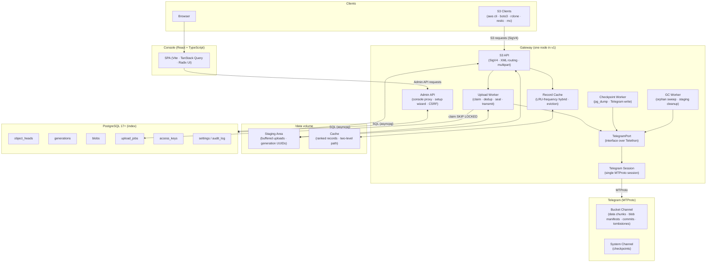
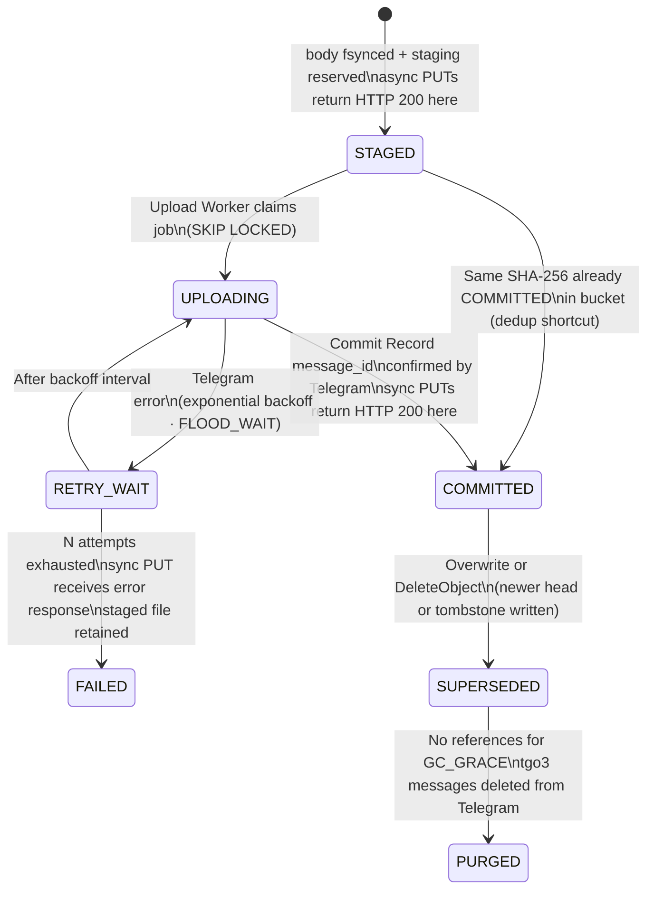
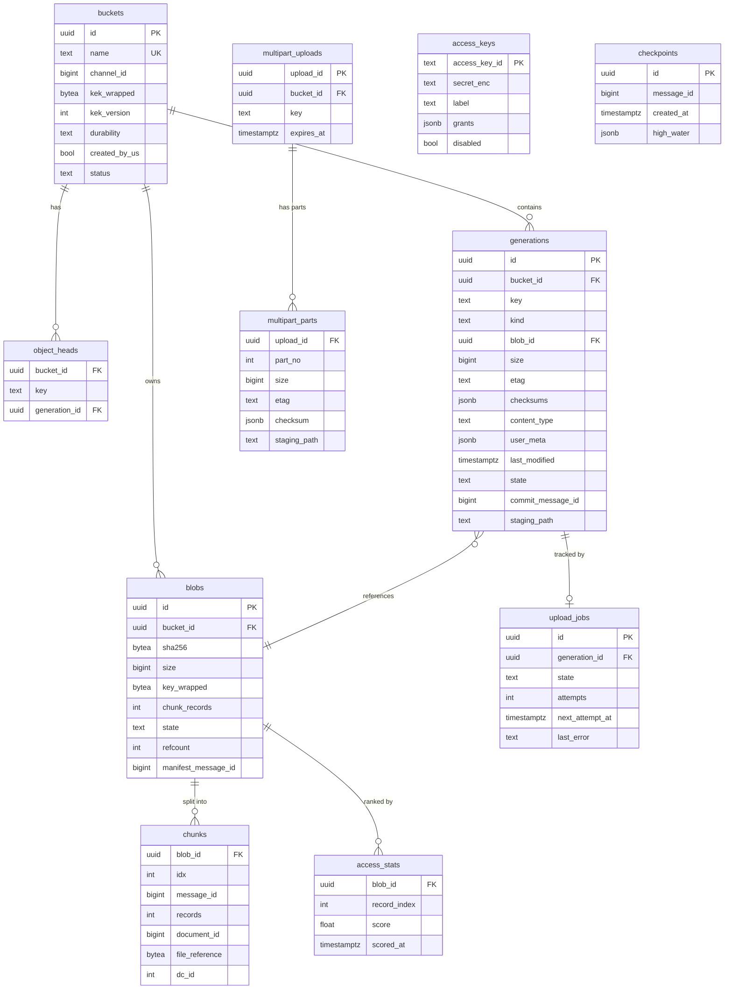

# Design Document — TGOBJECTS3

## Overview

TGOBJECTS3 is a self-hosted, single-node S3-compatible gateway that uses Telegram as its durable backing store and PostgreSQL as a rebuildable index. Operators deploy it with a single `docker compose up`; S3 clients (AWS CLI v2, boto3, rclone, restic, MinIO mc) connect without modification.

The positioning is deliberately narrow: cold, unlimited, free-to-store secondary archive. Telegram acts as a write-once message log — every object write appends a sequence of sealed record documents followed by a blob manifest and a commit record to a private channel. The commit record is the durability boundary: a generation is durable once Telegram returns a message-id for its commit record. PostgreSQL holds a fully rebuildable index of heads, generations, blobs, and upload jobs; losing the database means running the recovery CLI, not losing data.

### Design Goals

- **Correctness first.** The storage format is frozen at M1 before the service layer is built. Every binary codec has round-trip tests. The upload path is a state machine with a crash-safe journal (the Telegram channel itself).
- **Standard S3 surface.** Clients speak to a v4-signed HTTP endpoint. The gateway translates S3 semantics to Telegram operations transparently.
- **Bounded resource use.** Staging and cache are explicitly size-limited. Back-pressure is surfaced to clients as standard S3 errors (507, 503) rather than silent drops.
- **Operator self-sufficiency.** A recovery kit and CLI let an operator rebuild the entire index from Telegram alone. No proprietary tooling is needed.

### Milestone Roadmap

```mermaid
gantt
    title TGOBJECTS3 Milestone Roadmap
    dateFormat  X
    axisFormat  M%s

    section M0 Feasibility
    MB/s up & down, cold TTFB, flood behaviour, channel caps :m0, 0, 1
    Numbers recorded, chunk size chosen                        :m0b, 0, 1

    section M1 Storage Format
    AEAD records, blob manifests, commit records, rebuild CLI  :m1, 1, 2
    Overwrites and deletes rebuilt without DB                  :m1b, 1, 2

    section M2 Single Node
    S3 + trailers, bounded staging, sync commit, record cache  :m2, 2, 3
    restic / rclone / aws cli pass                             :m2b, 2, 3

    section M3 Hardening
    Fault injection, GC, orphan sweep, security review         :m3, 3, 4
    500 GB soak, every crash point explainable                 :m3b, 3, 4

    section M4 Console
    Setup + kit, pending writes, recovery status, docs         :m4, 4, 5
    Drill from docs passes → v1.0                              :m4b, 4, 5
```



---

## Architecture

### System Architecture



The gateway is intentionally a single Python process under uvicorn/uvloop. All concurrency is async I/O; CPU-bound work (AES-256-GCM, checksum computation) is dispatched to a thread pool. There is exactly one Telegram session per gateway instance — this is both a Telegram constraint and a design simplification.

### Generation State Machine

Every object write (PutObject, completed multipart, DeleteObject) is a **generation**. The state machine below governs how a generation moves from receipt to durable storage.



Key invariants:
- A generation is **durable** only at COMMITTED — Telegram holds the commit record.
- Sync PUT clients block until COMMITTED; async PUT clients return 200 at STAGED.
- The dedup shortcut skips Telegram upload entirely when the same SHA-256 exists as a COMMITTED blob in the same bucket; only a generation row and object_heads update are needed.
- STAGED and UPLOADING generations are re-enqueued on gateway restart (crash safety).
- PURGED generations are retained in PostgreSQL for audit; only the Telegram messages are deleted.

### Request Flows

**PUT (sync, new object):**
```
Client → SigV4 verify → staging reserve → stream + checksum →
fsync + rename → DB: insert generation(STAGED) + upload_job →
[Upload Worker claims] → dedup check → seal records → 
send chunks → send blob manifest → send commit record →
DB: mark COMMITTED + advance head → HTTP 200 → Client
```

**GET (ranged read, partial cache hit):**
```
Client → SigV4 verify → resolve head → validate Range →
map to record numbers → cache lookup →
[miss] → refresh file_references → fetch from Telegram (READ_AHEAD) →
verify AES-GCM tag → stream bytes → HTTP 206 → Client
```

---

## Components and Interfaces

### TelegramPort

The `TelegramPort` is the single boundary between the rest of the gateway and Telethon. All Telegram operations pass through this interface — no other module imports Telethon directly.

```python
class TelegramPort(Protocol):
    async def send_document(
        self, channel_id: int, data: bytes, file_name: str, caption: str
    ) -> int: ...  # returns message_id

    async def get_messages(
        self, channel_id: int, ids: list[int]
    ) -> list[TelegramMessage]: ...

    async def download_document(
        self, channel_id: int, message_id: int
    ) -> bytes: ...

    async def create_channel(self, title: str) -> int: ...  # channel_id
    async def delete_channel(self, channel_id: int) -> None: ...

    async def get_session_state(self) -> SessionState: ...
    async def is_connected(self) -> bool: ...
```

The Telethon adapter wraps this interface. In tests, a fake adapter replays pre-recorded message sequences or injects faults.

### S3 API Layer (`app/s3/`)

Handles routing, SigV4 authentication, XML serialization/deserialization, and the full S3 operation surface. Key sub-modules:

- **`sigv4.py`** — SigV4 header and presigned query-string authentication; timing window enforcement; bcrypt verification of secrets; chunk-signature verification for `STREAMING-AWS4-HMAC-SHA256-PAYLOAD`.
- **`router.py`** — FastAPI routes dispatched by HTTP method and presence of query parameters (e.g., `?uploads`, `?partNumber`).
- **`xml_codecs.py`** — Typed serializers/deserializers for all S3 XML response bodies (ListObjectsV2, CompleteMultipartUpload, etc.).
- **`multipart.py`** — CreateMultipartUpload, UploadPart, CompleteMultipartUpload, AbortMultipartUpload, ListParts, ListMultipartUploads.
- **`checksums.py`** — CRC32, CRC32C, CRC64NVME, SHA-1, SHA-256 computation via `hashlib` and `awscrt`.

### Format Layer (`app/format/`)

Pure (no I/O) codecs for every binary/serialized type used in Telegram messages. This layer is the primary target of property-based testing.

- **`record_codec.py`** — AES-256-GCM seal/unseal for 1 MiB records; AAD construction.
- **`blob_manifest.py`** — BlobManifest serializer/deserializer.
- **`commit_record.py`** — CommitRecord serializer/deserializer.
- **`tombstone.py`** — Tombstone serializer/deserializer.
- **`bucket_manifest.py`** — BucketManifest serializer/deserializer; KEK wrap/unwrap.
- **`checkpoint.py`** — Checkpoint serializer/deserializer; encrypted pg_dump envelope.
- **`key_wrap.py`** — AES Key Wrap (RFC 3394) using the `cryptography` library.
- **`sigv4_parser.py`** — Authorization header parser; extracts Credential, SignedHeaders, Signature.

### Storage Layer (`app/storage/`)

Orchestrates the lifecycle of generations, blobs, and object heads against PostgreSQL.

- **`generations.py`** — Insert STAGED generation; advance COMMITTED; state transitions.
- **`blobs.py`** — Dedup claim (via `UNIQUE(bucket_id, sha256)` advisory locking); refcount management.
- **`heads.py`** — Update `object_heads` atomically with generation commit.
- **`staging.py`** — In-memory reservation counter; fsync helpers; crash-recovery scan at startup.

### Upload Worker (`app/jobs/upload_worker.py`)

A background asyncio task (one or more, controlled by `UPLOAD_CONCURRENCY`) that:

1. Claims an upload_job with `SELECT ... FOR UPDATE SKIP LOCKED`.
2. Checks dedup: `SELECT id FROM blobs WHERE bucket_id = $1 AND sha256 = $2 AND state = 'committed'`.
3. If dedup hit: inserts generation row pointing at existing blob; marks COMMITTED in one transaction.
4. If concurrent upload of same SHA-256: waits on a `pg_advisory_lock(sha256_as_int64)` until the other worker finishes.
5. Otherwise: seals records in thread pool (one `asyncio.to_thread` per chunk batch); sends chunk documents in parallel up to `UPLOAD_CONCURRENCY`; sends blob manifest; sends commit record.
6. On Telegram error: applies exponential backoff (1 s doubling, max configurable), respects FLOOD_WAIT delays, increments attempt counter; transitions to FAILED after max attempts.

### Record Cache (`app/cache/`)

Two-level filesystem path: `/data/cache/{blob_id[:2]}/{blob_id}/{record_index}`.

**Admission policy:**
- Objects ≤ 64 MiB: all records admitted on first access.
- Objects > 64 MiB: admitted in 8-record blocks; cold blocks admitted only on second access within one half-life (prevents sequential scan thrashing).

**Ranking score:**
```
s(t) = s_prev × 2^(−Δt / H) + 1
priority(t) = s(t) / size^α
```
where H = `CACHE_HALF_LIFE` (default 86400 s) and α = `CACHE_SIZE_BIAS` (default 0.5).

**Eviction:** Background task wakes when cache reaches `CACHE_HIGH_WATERMARK` (90%); evicts lowest-priority records until `CACHE_LOW_WATERMARK` (80%).

**Concurrency:** Concurrent misses for the same record share a single `asyncio.Event`; exactly one Telegram download occurs.

**Optional encryption:** When `CACHE_ENCRYPT=true`, each cached record file is AES-256-GCM encrypted using a key derived from the master key via HKDF.

### Admin API (`app/admin/`)

Serves the React console via an API proxy. Key endpoints:

- `GET /admin/buckets` — list with per-bucket stats.
- `GET /admin/objects` — prefix-filtered object browser with pagination.
- `GET /admin/jobs` — upload job list with retry action.
- `GET/PUT /admin/settings` — runtime config (effective within 5 s, no restart).
- `POST /admin/setup/*` — guided setup wizard steps.
- `GET /admin/keys`, `POST /admin/keys`, `DELETE /admin/keys/{id}` — access key management.
- `GET /health/live`, `GET /health/ready`, `GET /metrics` — observability endpoints on admin port.

All write endpoints validate a CSRF token in the request header against the session-bound token.

### Recovery CLI (`cli/rebuild`)

Scans Telegram channels in ascending message-id order, decrypts Commit Records and Tombstones using master key + bucket KEKs, and inserts generation rows into PostgreSQL. Designed for total index loss recovery without any prior database state.

---

## Data Models

### PostgreSQL Schema



### Telegram Message Format

Every Telegram message carries a typed caption string used as the message identifier during channel scan:

| Caption prefix | Content | Written |
|---|---|---|
| `tgo3-d-<blob_id>-<chunk_idx>` | Sealed AES-256-GCM records (raw bytes) | First, for each chunk |
| `tgo3-b-<blob_id>` | BlobManifest (msgpack) | After all chunks confirmed |
| `tgo3-c-<generation_id>` | CommitRecord (msgpack) | Last — durability boundary |
| `tgo3-t-<generation_id>` | Tombstone (msgpack) | On DeleteObject |
| `tgo3-k-<version>` | BucketManifest (msgpack) | On bucket creation / key rotation |
| `tgo3-p-<timestamp>` | Checkpoint (msgpack + encrypted pg_dump) | System channel, periodic |

### Key Hierarchy

```
TGOS3_MASTER_KEY (env, min 16 chars)
    │
    └─ HKDF-SHA256 → 32-byte root AES key
            │
            ├─ bucket KEK  (random 32 bytes, per bucket)
            │      wrapped by root key → AES Key Wrap (RFC 3394)
            │      stored in BucketManifest message
            │
            └─ blob key  (random 32 bytes, per blob)
                   wrapped by bucket KEK → AES Key Wrap (RFC 3394)
                   stored in BlobManifest message
```

HKDF domain separation info string: `"tgobjects3-v1-root"`.

### Record Wire Format

```
┌────────────────────────────────────────────────────────────────┐
│  12 bytes   nonce (record_index big-endian, zero-padded)       │
├────────────────────────────────────────────────────────────────┤
│  1,048,560 bytes  AES-256-GCM ciphertext                       │
├────────────────────────────────────────────────────────────────┤
│  16 bytes   GCM authentication tag                             │
└────────────────────────────────────────────────────────────────┘
Total: 1,048,588 bytes per record
```

AAD (additional authenticated data): `format_version(1 byte) || blob_id(16 bytes) || record_index(4 bytes, big-endian) || total_plaintext(8 bytes, big-endian) || is_last(1 byte)`.

### Offset Mapping

For a byte offset `o` within a blob (R = 1,048,560 bytes per record, n = `CHUNK_RECORDS` = 512 records per chunk):

```
record r    = floor(o / R)
chunk  c    = floor(r / n)
intra-chunk offset d = (r mod n) × 2^20
```

### Configuration

Key configuration variables with defaults:

| Variable | Default | Notes |
|---|---|---|
| `TGOS3_MASTER_KEY` | — | Required; env-only |
| `DATABASE_URL` | — | Required; env-only |
| `S3_PORT` | 9000 | |
| `ADMIN_PORT` | 8080 | |
| `S3_REGION` | `us-east-1` | |
| `CHUNK_RECORDS` | 512 | Records per Telegram document |
| `DEFAULT_DURABILITY` | `sync` | `sync` or `async` per bucket |
| `GC_GRACE` | `7d` | Retention before Telegram deletion |
| `CHECKPOINT_INTERVAL` | `24h` | Range: 60 s – 86400 s |
| `STAGING_MAX_SIZE` | `16GiB` | |
| `CACHE_MAX_SIZE` | `4GiB` | |
| `CACHE_HALF_LIFE` | `24h` | In seconds for formula |
| `CACHE_SIZE_BIAS` | 0.5 | α in priority formula |
| `CACHE_HIGH_WATERMARK` | 0.90 | Triggers eviction |
| `CACHE_LOW_WATERMARK` | 0.80 | Eviction target |
| `READ_AHEAD` | 4 | 0–32 blocks |
| `UPLOAD_CONCURRENCY` | 2 | Parallel chunk uploads |
| `CACHE_ENCRYPT` | `false` | Encrypt cached records at rest |
| `MULTIPART_EXPIRY` | `24h` | Min 1 h |

---

## Correctness Properties

*A property is a characteristic or behavior that should hold true across all valid executions of a system — essentially, a formal statement about what the system should do. Properties serve as the bridge between human-readable specifications and machine-verifiable correctness guarantees.*

The format layer (records, manifests, commit records, SigV4 parser) and core algorithmic components (range mapping, staging reservation, cache ranking) are composed of pure functions with clear input/output contracts and a large input space — this is precisely where property-based testing adds the most value. Infrastructure wiring (Telegram connectivity, PostgreSQL schema), UI rendering, and side-effect-only operations (audit log writes, health checks) are tested with example-based or integration tests instead.

**Property reflection:** Requirements 22.3/22.4 (CommitRecord) and 22.5/22.6 (BlobManifest) each describe a single round-trip in both directions — serialise→deserialise and deserialise-from-serialised — which are equivalent statements captured by one property each. Requirement 22.7 (SigV4 field extraction without modification) is subsumed by requirement 22.8 (round-trip header equivalence), so they are merged into Property 5. Requirements 6.3 and 6.4 (staging reservation) are two sides of the same overflow invariant and are merged into Property 9.

### Property 1: Record codec round-trip

*For any* plaintext input of 1 to 1,048,560 bytes, a random 256-bit AES key, and a valid blob_id and record_index, sealing the plaintext with `record_codec.seal` and then unsealing the resulting ciphertext with `record_codec.unseal` using the same key SHALL produce output that is byte-for-byte identical to the original plaintext.

**Validates: Requirements 22.2**

### Property 2: Record ciphertext length invariant

*For any* plaintext input of exactly 1,048,560 bytes, sealing with `record_codec.seal` SHALL produce a ciphertext (excluding the 12-byte nonce prefix) of exactly 1,048,576 bytes.

**Validates: Requirements 22.1**

### Property 3: CommitRecord serialisation round-trip

*For any* CommitRecord object with all required fields populated with values of their declared types, serialising with `commit_record.serialise` and then deserialising the result with `commit_record.deserialise` SHALL produce a CommitRecord whose every field compares equal by value to the original.

**Validates: Requirements 22.3, 22.4**

### Property 4: BlobManifest serialisation round-trip

*For any* BlobManifest object with all required fields populated with values of their declared types, serialising with `blob_manifest.serialise` and then deserialising the result with `blob_manifest.deserialise` SHALL produce a BlobManifest whose every field compares equal by value to the original.

**Validates: Requirements 22.5, 22.6**

### Property 5: SigV4 Authorization header round-trip

*For any* well-formed `Authorization` header containing all four required fields (Algorithm, Credential, SignedHeaders, Signature) conforming to the AWS SigV4 specification, parsing with `sigv4_parser.parse` and then formatting the extracted fields back into an `Authorization` header SHALL produce a header whose Algorithm, Credential, SignedHeaders, and Signature field values are identical to those of the original header.

**Validates: Requirements 22.7, 22.8**

### Property 6: SigV4 parser rejects malformed headers

*For any* `Authorization` header missing at least one of the four required fields or containing any field in a format that does not conform to the SigV4 specification, `sigv4_parser.parse` SHALL return a structured parse error value containing an error kind indicator and the position or field name at which parsing failed, and SHALL NOT raise an unhandled exception.

**Validates: Requirements 22.9**

### Property 7: Object listing excludes non-COMMITTED generations

*For any* bucket state containing a mix of STAGED, UPLOADING, COMMITTED, DELETED, and SUPERSEDED generations across any set of object keys, a ListObjectsV2 query against that state SHALL return only generations whose state is COMMITTED, and no key shall appear more than once in Contents.

**Validates: Requirements 5.4**

### Property 8: ListObjectsV2 delimiter produces disjoint lexicographically-ordered results

*For any* set of object keys in a bucket, any prefix, and any single-character delimiter, applying ListObjectsV2 with that prefix and delimiter SHALL produce a response where no key appears in both `Contents` and `CommonPrefixes`, all entries in `Contents` are in lexicographic order, and all entries in `CommonPrefixes` are in lexicographic order.

**Validates: Requirements 5.2**

### Property 9: Staging reservation prevents overflow

*For any* sequence of concurrent PutObject requests whose individual Content-Length values are each individually within bounds, the total sum of in-progress staging reservations SHALL never exceed `STAGING_MAX_SIZE`; any request whose reservation would cause the total to exceed that limit SHALL receive HTTP 507 and SHALL NOT have any staging bytes written.

**Validates: Requirements 6.3, 6.4**

### Property 10: AES Key Wrap round-trip

*For any* 256-bit key-encryption-key and any 256-bit plaintext key material, wrapping with `key_wrap.wrap` (RFC 3394) and then unwrapping with `key_wrap.unwrap` using the same KEK SHALL produce a result byte-for-byte identical to the original plaintext key material.

**Validates: Requirements 13.3, 13.4**

### Property 11: Range request maps to minimal record set

*For any* object of arbitrary size and any syntactically valid `Range: bytes=start-end` header whose range lies entirely within the object, computing the record set with `range_mapper.records_for_range` SHALL return a contiguous set of record indices that fully covers every byte in `[start, end]` and whose total byte span is minimal (i.e., removing any single record from the set would leave at least one requested byte uncovered).

**Validates: Requirements 8.2**

### Property 12: Dedup does not re-upload identical content

*For any* bucket and any two PutObject calls supplying byte-for-byte identical bodies, the second call SHALL result in a new COMMITTED generation that references the same blob row (by `blob_id`) as the first call, and no new Telegram document upload operations SHALL be performed for the second call.

**Validates: Requirements 6.10**

### Property 13: Cache ranking score decays over time and scales with access frequency

*For any* cached record score `s`, elapsed time `Δt` greater than zero, and half-life `H` greater than zero, the decayed score `s × 2^(−Δt / H)` SHALL be strictly less than `s`; and for any two records with equal sizes and equal elapsed time since scoring, the record with the higher cumulative score (more accesses) SHALL have a strictly higher priority value than the record with the lower cumulative score.

**Validates: Requirements 12.2**

---

## Error Handling

### Startup Failures

- Missing required environment variables: gateway logs each missing variable on its own line to stderr and exits non-zero before binding any port.
- PostgreSQL unavailable: retried up to 10 times at 3-second intervals; exits with non-zero code and error message if all attempts fail.
- Failed Alembic migration: gateway halts immediately, logs the migration name, and does not accept requests.

### Request Errors

| Condition | HTTP Status | Notes |
|---|---|---|
| SigV4 signature mismatch | 403 | `SignatureDoesNotMatch` |
| Timestamp outside ±15 min | 403 | `RequestTimeTooSkewed` |
| Content-MD5 mismatch | 400 | Staging file deleted |
| Checksum mismatch (any algorithm) | 400 | Staging file deleted |
| Body exceeds MAX_OBJECT_SIZE | 413 | Body discarded |
| Staging space exhausted | 507 | No body written |
| Telegram unavailable during upload | 503 | STAGED generation retained |
| Telegram unavailable during delete | 500 | Index unchanged |
| AES-GCM tag verification failure | 500 | Connection closed, no bytes flushed |
| Invalid Range header | 416 | `Content-Range` with actual size |
| Bucket already exists | 409 | `BucketAlreadyExists` |
| Bucket not empty | 409 | `BucketNotEmpty` |
| Object not found | 404 | HeadObject, GetObject |
| Invalid continuation token | 400 | `InvalidArgument` |
| Unsupported checksum algorithm | 400 | `InvalidRequest` |
| DeleteObjects > 1000 keys | 400 | `MalformedXML` |
| UploadId invalid / completed | 404 | `NoSuchUpload` |
| Part list invalid | 400 | `InvalidPart` |

### Telegram Reconnection

On disconnect: detect within 30 seconds; exponential backoff starting at 1 s, doubling, up to a configurable maximum (default 60 s, range 5–300 s). While disconnecting or reconnecting, all requests requiring Telegram return HTTP 503 without modifying committed state.

### Upload Retry

Upload Worker applies exponential backoff on Telegram errors. Respects `FLOOD_WAIT` responses. After max attempts, sets generation to FAILED and surfaces the error. The STAGED file is retained for manual inspection or operator-initiated retry.

### Crash Recovery

On startup, the gateway scans the staging directory:
- Staging files with no corresponding generation row → quarantined (moved to `/data/staging/quarantine/`).
- Generation rows in STAGED or UPLOADING state with no upload_job → re-enqueue upload job.
- Generation rows in STAGED or UPLOADING state with an existing upload_job → skip (idempotent).

### Partial Commit Record Recovery

If a Blob Manifest exists in Telegram but no Commit Record exists (gateway crashed between writing the manifest and writing the commit record): re-attempt to write the Commit Record up to 5 times with exponential backoff. If all 5 attempts fail, the generation is set to UPLOAD_FAILED and an error is surfaced to the operator.

### Master Key Rotation Atomicity

Key rotation re-wraps all bucket KEKs and updates all Bucket Manifests in Telegram. If rotation fails partway through, the previous key wrapping is retained for any manifests not yet updated; the CLI reports exactly which manifests were and were not updated so the operator can retry the remaining ones.

### Audit Log Write Failure

If an audit log write fails, the gateway continues processing the S3 request and increments the `audit_log_write_failures_total` Prometheus counter. Audit log failures are never surfaced to S3 clients.

---

## Testing Strategy

### Overview

Testing is organised in four layers:

1. **Property-based tests** — verify universal correctness of the format layer codecs and core logic across thousands of generated inputs.
2. **Example-based unit tests** — verify specific behaviours, edge cases, and error conditions that are not cost-effective to express as properties.
3. **Integration tests** — verify end-to-end behaviour against real PostgreSQL (via testcontainers) and a Telegram test server.
4. **Workflow matrix tests** — verify S3 client compatibility at pinned client versions (AWS CLI v2, boto3, rclone, restic, MinIO mc).

### Property-Based Testing

**Library:** `hypothesis` (Python). Each property test runs a minimum of 100 iterations; `settings(max_examples=500)` for the most critical properties (codec round-trips).

Each property test is tagged with a comment referencing the design property:
```python
# Feature: tgobjects3, Property 1: Record codec round-trip
```

Properties 1–13 above map directly to `hypothesis`-driven tests in `tests/unit/test_format_properties.py`, `tests/unit/test_listing_properties.py`, and `tests/unit/test_cache_properties.py`.

**Generators to implement:**
- `plaintext_bytes(min_size=1, max_size=1_048_560)` — `hypothesis.strategies.binary`
- `aes_key_256()` — `hypothesis.strategies.binary(min_size=32, max_size=32)`
- `blob_id()` — `hypothesis.strategies.binary(min_size=16, max_size=16)`
- `commit_record()` — composite strategy covering all CommitRecord field types
- `blob_manifest()` — composite strategy covering all BlobManifest field types
- `sigv4_auth_header()` — generates well-formed and malformed variants
- `object_key_set()` — set of valid S3 object keys with controlled prefix/delimiter structure
- `bucket_with_generations()` — bucket state with mixed generation statuses
- `range_header(object_size)` — valid and invalid Range header variants
- `cache_score_inputs()` — (s_prev, delta_t, H, size, alpha) tuples with valid domains

### Example-Based Unit Tests

Focus areas:
- SigV4 timestamp window boundary (exactly ±15 minutes).
- STAGING_MAX_SIZE exactly at limit (507) and one byte under (200).
- CompleteMultipartUpload with invalid part list (missing part, zero parts).
- ListObjectsV2 pagination: last page, empty bucket, max-keys=1.
- Conditional headers (If-Match, If-None-Match, If-Modified-Since, If-Unmodified-Since) — each of the four cases.
- Setup wizard 2FA retry count boundary (3rd attempt, 4th attempt).
- Docker startup with each required environment variable missing individually.
- Master key rotation with simulated mid-rotation failure.
- Record cache eviction: exact high/low watermark crossings.
- Format version ≠ 1: rejection in gateway and recovery CLI.

### Integration Tests

Run with `pytest` + `testcontainers` (real PostgreSQL 17, Telegram test server via `Pyrogram` test DC or custom stub):
- Full PutObject → GetObject round-trip (sync durability).
- Full PutObject → GetObject round-trip (async durability).
- Multipart upload: 3 parts, complete, get.
- DeleteObject then GetObject → 404.
- CopyObject within bucket (dedup path verified via upload_jobs count).
- Recovery CLI: insert commit records directly, wipe PostgreSQL, run rebuild, verify heads.
- Checkpoint write and checkpoint-based recovery scan start point.
- Concurrent uploads of same SHA-256 (dedup race): exactly one Telegram upload.
- Crash simulation: kill gateway after Blob Manifest written, restart, verify COMMITTED.
- GC worker: verify staging file and Telegram messages purged after GC_GRACE.

### Workflow Matrix Tests

Pinned client versions recorded in `tests/workflow_matrix/pin.json`. Each client is tested with `pytest-subprocess` or a real local gateway + Docker:
- **AWS CLI v2**: bucket CRUD, put, get, delete, multipart, `--checksum-algorithm` variants.
- **boto3**: bucket CRUD, object CRUD, multipart, listing.
- **rclone**: `copy`, `sync`, `mount` (FUSE, read-only assertions).
- **restic**: `init`, `backup`, `restore`, `snapshots`.
- **MinIO mc**: bucket and object management.

### Observability Tests

- `/health/live` returns 200 on healthy gateway; 503 when in non-recoverable state.
- `/health/ready` returns 503 with body identifying `postgresql` when DB is down.
- `/health/ready` returns 503 with body identifying `telegram` when session is disconnected.
- `/metrics` endpoint returns valid Prometheus text format.
- Audit log entries contain all required fields and have credentials redacted.

### Soak Test (M3)

500 GB upload/download soak over 24 hours using rclone against a staging deployment. Pass criteria: zero data integrity errors, no unrecovered FAILED generations, Prometheus `record_auth_failure_total` counter remains at zero.
